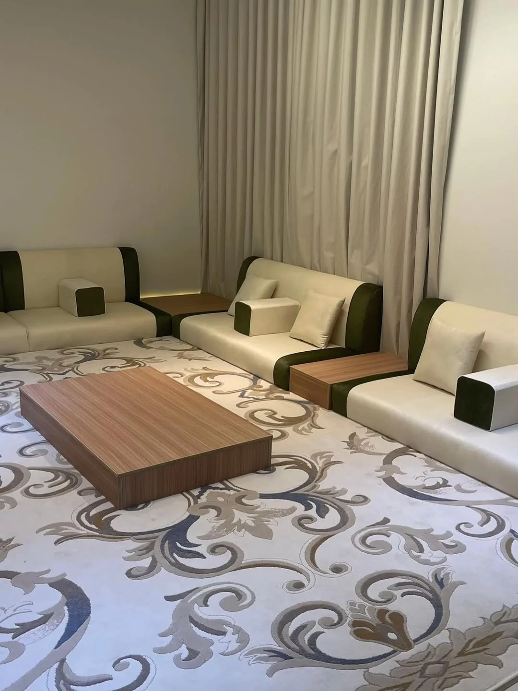

المجلس العربي جلسة على الجدران بمساند ظهر، ويُفصّل بنوعين: **أرضي** قريب من الأرض، و**مرتفع** بارتفاع الكنب.

## المجلس الأرضي

- جلسة تقليدية قريبة من الأرض.
- يناسب الجلسات الشعبية والسهرات.
- أقل مناسبة لكبار السن لأن القيام منه أصعب.

## المجلس المرتفع

- بارتفاع الكنب، فالجلوس والقيام أسهل.
- يناسب البيوت التي فيها كبار سن.

## الجمع بين الاثنين

يمكن تفصيل جلسة أرضية على جدار وكنب على جدار آخر. شاهد [مجالس عربية](/majalis-arabiya/).

## المساند

- **مساند أسطوانية** للاتكاء على الجانبين.
- **مساند ظهر** مربعة أو مستطيلة.

## السعر

بالمتر الطولي شامل القماش، ويبدأ في الموقع من **24 د.ك للمتر** حسب التصميم. والصناديق الخشبية بين القطع بالاتفاق.
