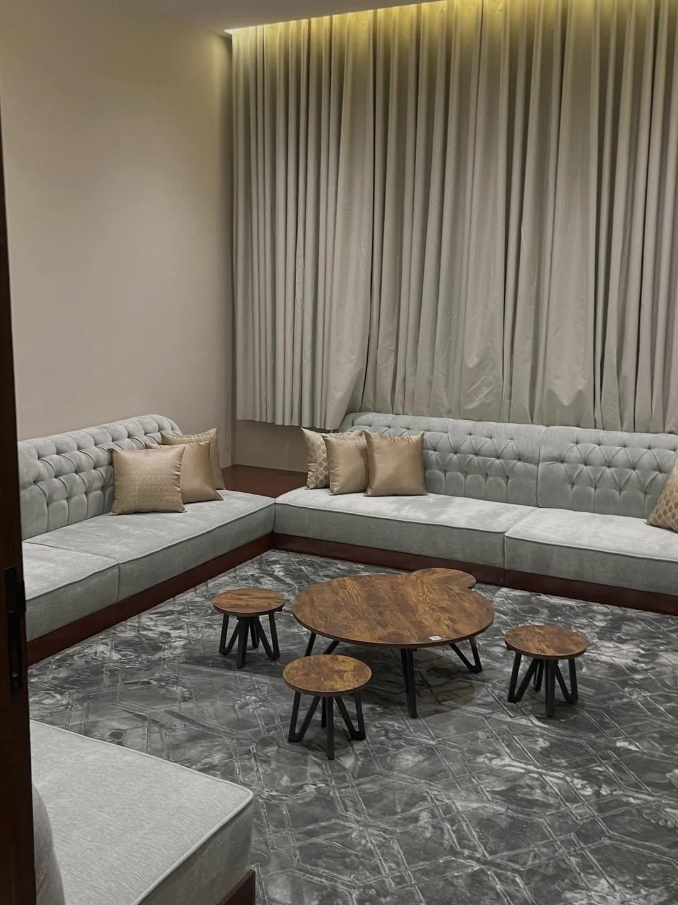

**الكابتونيه** طريقة تنجيد تُشد فيها الأقمشة بأزرار أو غرز على مسافات منتظمة، فتتكون مربعات أو معينات بارزة. ويعطي الكنب مظهراً غنياً بالتفاصيل.

## أين يناسب؟

- **الكنب الكلاسيك** والمجالس الرسمية. اقرأ [الكنب الكلاسيك](/blog/classic-sofa-guide/).
- **الكنب المودرن** بظهر كابتونيه بسيط.
- **كنب الديوانية**.

## القماش

المخمل يُظهر الكابتونيه أكثر، لأن الضوء يتغير على الثنيات. والأقمشة المنسوجة تعطيه مظهراً أهدأ.

## العناية

- الغبار يتجمع بين الأزرار. استخدم **فوهة المكنسة الضيقة** أو فرشاة ناعمة أسبوعياً.
- لا تشد الأزرار أو تعلق عليها أشياء.

شاهد كنب [زاوية كابتونيه](/kanab-zawiya/) و[أطقم بظهر كابتونيه](/atqam-kanab/).
