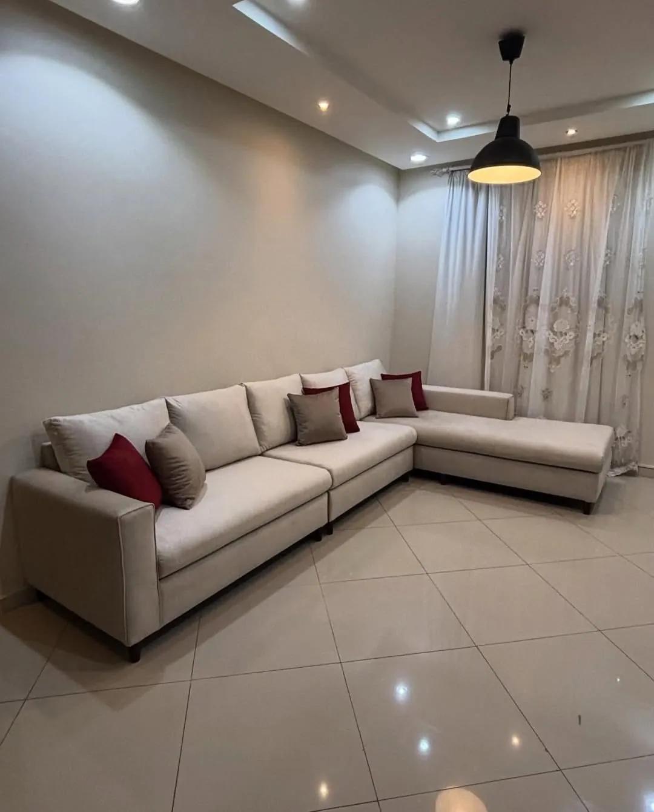

الطرف الممدود (يسميه البعض شيزلونج) يجعل كنب الزاوية مكاناً للاستلقاء. لكن جهته تُحدد قبل التفصيل ولا تتغير بعده.

## أكثر خطأ: لبس اليمين واليسار

حدد الجهة وأنت **واقف أمام الكنب تنظر إليه**. الجهة على يمينك هي اليمين. وأرسل صورة المكان مع الطلب لنتأكد معك.

## كيف تختار الجهة؟

- **باتجاه التلفزيون:** حتى ترى الشاشة وأنت ممدد.
- **بعيداً عن الباب:** حتى لا يسد الطرف الممدود الممر.
- **بعيداً عن النافذة المنخفضة** إذا كنت تفتحها كثيراً.

## طرفان ممدودان

في الكنب المستقيم الطويل يمكن طرف ممدود في كل جهة. شاهد [الكنب المودرن](/kanab-modern/).

## الطول والسعر

الطرف الممدود يدخل في طول الضلع، ويُحسب بالمتر الطولي. اقرأ [كيف يُحسب السعر](/blog/sofa-tailoring-price-per-metre/).
