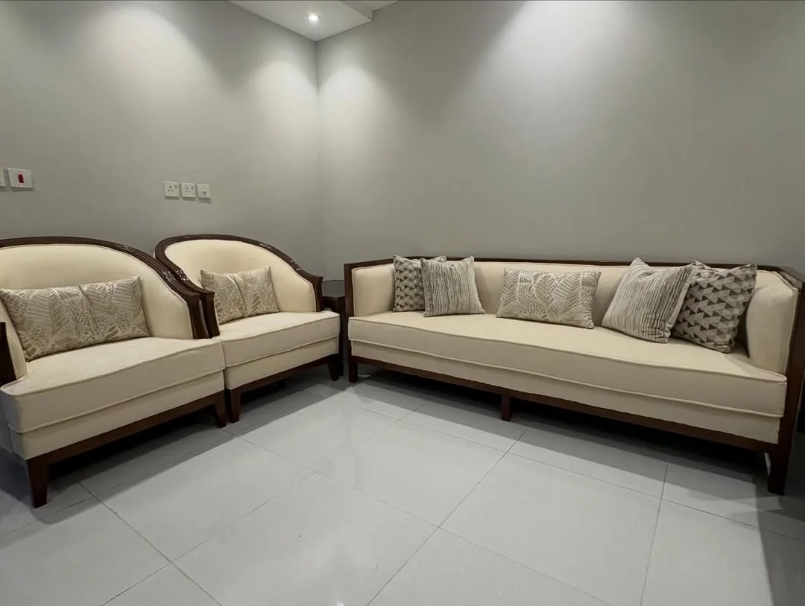

الكنب الكلاسيك يعتمد على التفاصيل: خشب ظاهر، وخطوط منحنية، وقماش بلمعة خفيفة. ويناسب الصالات الرسمية والمجالس.

## ملامحه

- **إطار خشبي ظاهر** حول الظهر أو الأذرع.
- **أذرع ملفوفة** أو منحنية.
- **أرجل منحوتة** أو مخروطية.
- أحياناً **ظهر كابتونيه** بأزرار.

## القماش

المخمل والأقمشة ذات اللمعة الخفيفة تُبرز تفاصيله. والألوان الكريمي والأخضر الزيتي والعنابي شائعة معه.

## لمن يناسب؟

- صالات الضيوف الرسمية.
- البيوت بديكور كلاسيكي: كورنيش، وثريات، وستائر بحمالات.

## السعر

بالمتر الطولي شامل القماش، ويختلف حسب كمية الخشب والتفاصيل. سعر كل تصميم في صفحته. شاهد [الكنب الكلاسيك](/kanab-classic/).
