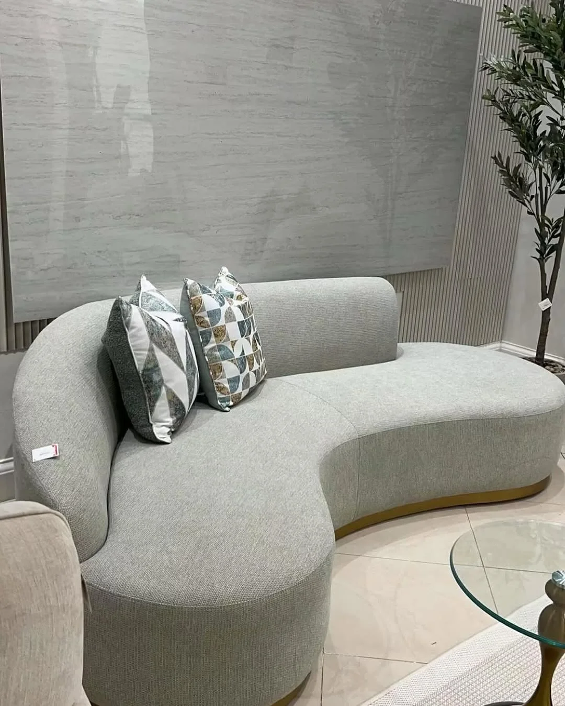

الكنب المنحني يكسر الخطوط المستقيمة في الصالة، ويعطي جلسة تواجه بعضها. وصار من أكثر التصاميم المودرن طلباً.

## أين يناسب؟

- **وسط الصالة** الكبيرة، أمام طاولة دائرية.
- **جدار واحد** في غرفة جلوس أو مدخل.
- **الصالات المفتوحة** لفصل منطقة الجلوس دون جدار.

## متى لا يناسب؟

الزوايا الضيقة، لأن الانحناء يترك فراغاً خلفه. هنا الأنسب [كنب زاوية](/kanab-zawiya/) بأطراف مستديرة.

## القماش

البوكليه والأقمشة المحببة تُظهر الانحناء أجمل من الأقمشة اللامعة. اقرأ [أنواع أقمشة الكنب](/blog/sofa-fabric-types/).

## القياس

يُقاس بطوله من الخلف على امتداد الانحناء. أرسل صورة المكان، ونقترح الطول المناسب.

شاهد نماذج [الكنب المودرن](/kanab-modern/).
