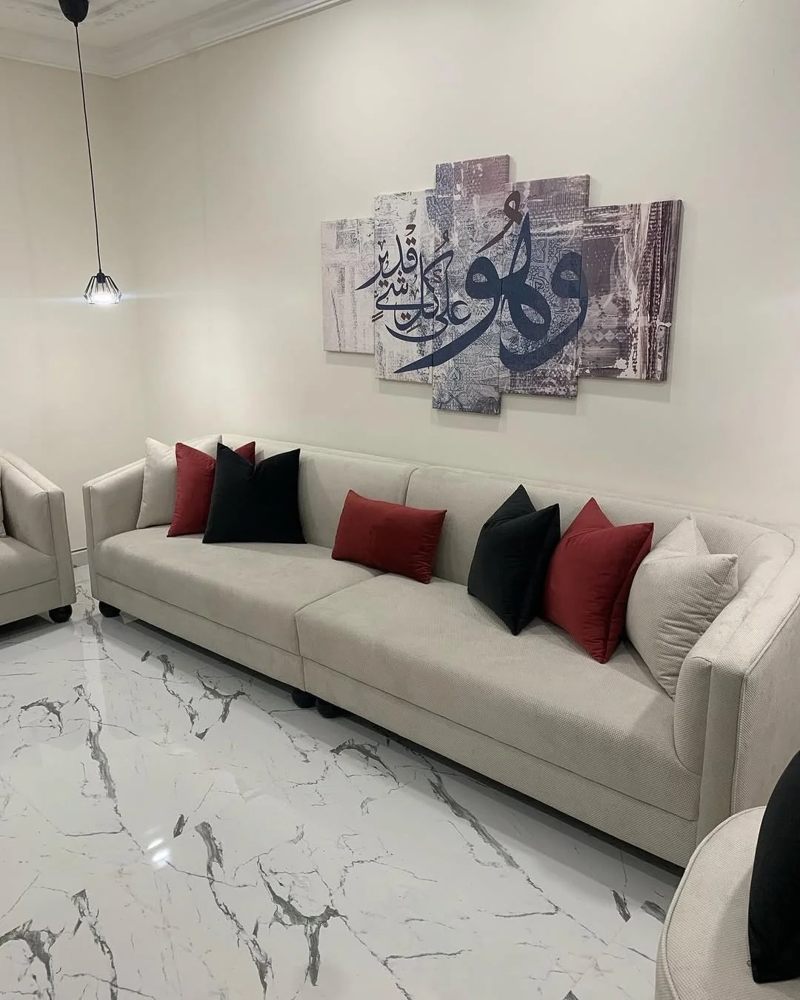

الطقم ليس بعدد ثابت. القطع تُختار حسب حجم الصالة واستخدامها.

## ابدأ من عدد الجالسين

احسب كم شخصاً يجلس عادةً في الصالة، وكم ضيفاً في المناسبات. هذا يحدد الطول الكلي المطلوب.

## أمثلة شائعة

| الصالة | اقتراح |
|---|---|
| صغيرة | كنب 3 + كنب 2 |
| متوسطة | كنب 3 + كنب 3 متقابلين |
| كبيرة | كنب 3 + كنب 3 + كرسيان |

## حساب الطول والسعر

اجمع أطوال القطع: كنبة 2.2 م + كنبة 1.8 م = 4 أمتار. على سعر 41 د.ك للمتر شامل القماش = **164 د.ك**. والكراسي المفردة بالاتفاق. والسعر يختلف حسب التصميم.

## نصيحة

اطلب الطقم كاملاً مرة واحدة. القطعة الإضافية لاحقاً قد يختلف لون قماشها قليلاً لأن دفعات القماش تختلف.

شاهد [أطقم الكنب](/atqam-kanab/).
