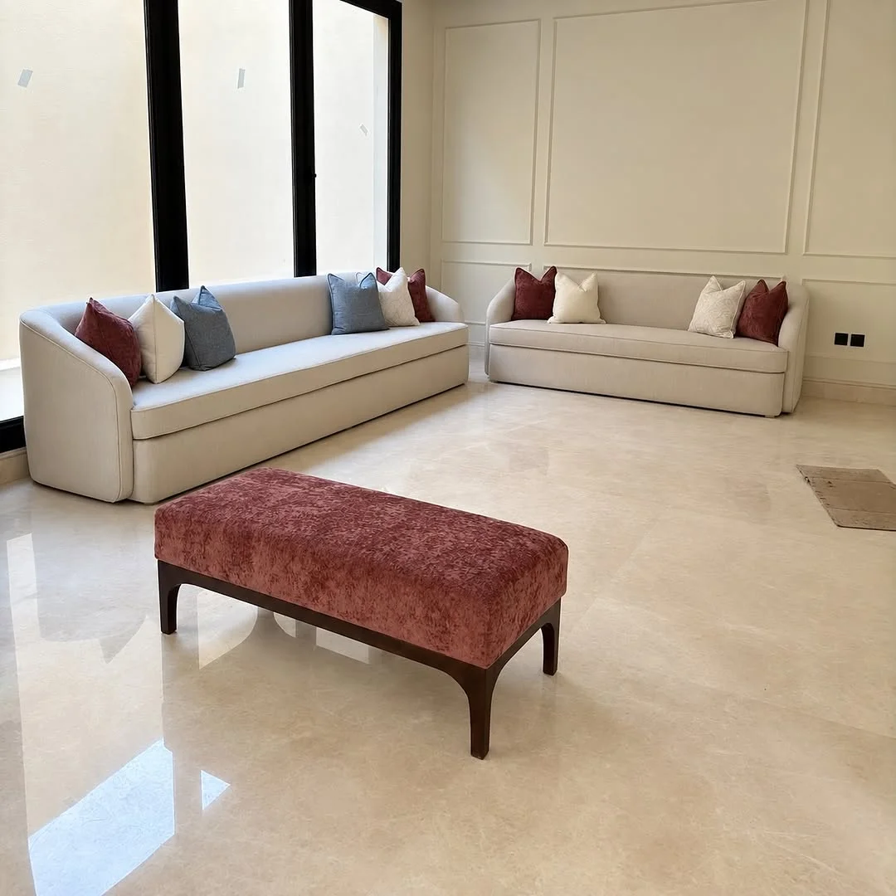

ترتيب الكنب يحدد كيف تُستخدم الصالة: للتلفزيون، أو للضيوف، أو للاثنين. وهذه أربعة ترتيبات عملية.

## 1. مقابل التلفزيون

كنب زاوية أو مستقيم يواجه الشاشة. مناسب لغرف الجلوس العائلية.

## 2. الجلسة المتقابلة

كنبتان متقابلتان بينهما طاولة. مناسبة لصالات الضيوف والحديث. شاهد [أطقم الكنب](/atqam-kanab/).

## 3. الزاوية الكاملة

[كنب زاوية](/kanab-zawiya/) يستغل جدارين، والجدار الثالث للتلفزيون. أو [حرف U](/blog/u-shaped-sofa-large-living-rooms/) على ثلاثة جدران.

## 4. فصل الصالة المفتوحة

في الصالة المفتوحة على المطبخ أو الطعام، ظهر الكنب يفصل منطقة الجلوس دون جدار. هنا يجب أن يكون **ظهر الكنب مكسواً بنفس القماش** لأنه ظاهر.

## مسافات لا تنسها

- ممر مريح للمرور بين الكنب والطاولة.
- مسافة لفتح الأبواب والنوافذ.
