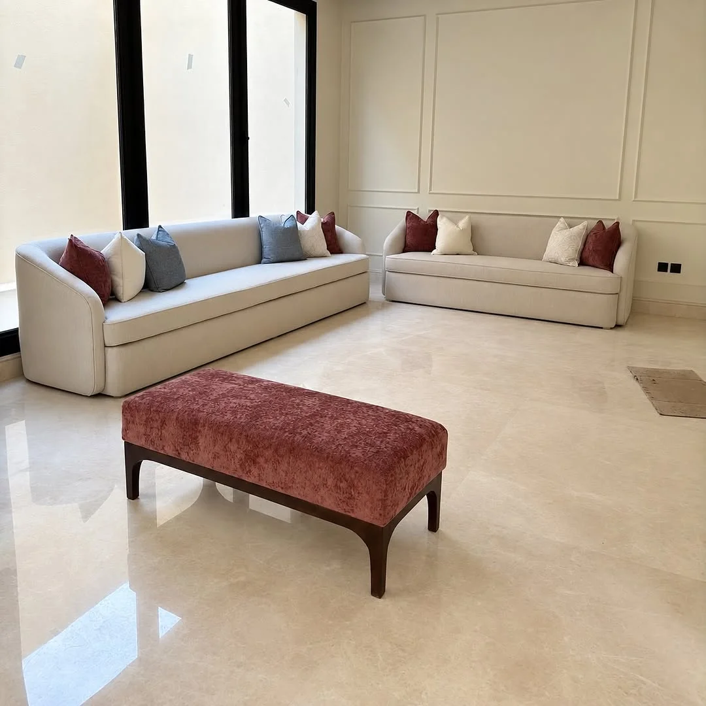

شمس الكويت القوية وغبارها أكبر عدوّين للكنب القماش. والوقاية أسهل من العلاج.

## الشمس

- **لا تضع الكنب مباشرة أمام نافذة** تدخل منها شمس الظهيرة.
- **أغلق الستارة** في ساعات الشمس القوية.
- الألوان الداكنة كالكحلي والأخضر الغامق يظهر عليها البهتان أكثر من البيج.

## الغبار

- **شفط أسبوعي** للكنب، خاصة بعد أيام الغبار.
- الغبار بين الألياف يجعل القماش يبدو باهتاً.
- **أغطية مؤقتة** للكنب في الغرف غير المستخدمة.

## إذا بهت القماش

البهتان لا يزول بالتنظيف. إذا كان الهيكل والإسفنج بحالة جيدة، فـ[التنجيد](/tanjeed-kanab/) بقماش جديد يعيد الكنب كما كان.

اقرأ [تنظيف الكنب القماش في البيت](/blog/clean-fabric-sofa-at-home/).
