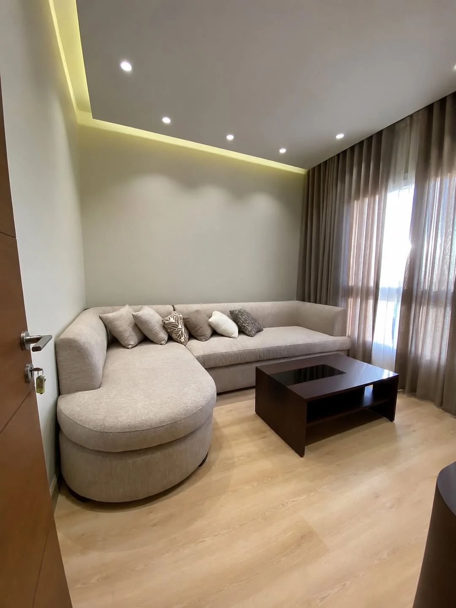

في الشقة الصغيرة كل سنتيمتر محسوب. والتفصيل يناسبها لأنك تحدد المقاس بدقة بدل البحث عن كنب جاهز يناسب.

## اختيارات مناسبة

- **[كنب زاوية](/kanab-zawiya/) صغير** يستغل زاوية الغرفة.
- **كنب نفرين** للغرف وغرف النوم.
- **طرف ممدود** بدل كرسي إضافي.

## تفاصيل تُظهر المساحة أوسع

- **أذرع رفيعة** بدل الأذرع العريضة.
- **أرجل ظاهرة** ترفع الكنب عن الأرض، فيظهر الرخام تحته.
- **ظهر منخفض** لا يغطي الجدار.
- **ألوان فاتحة**.

## قبل الطلب

- قِس الجدار والمسافة أمام الكنب.
- قِس **باب الشقة والمصعد**. الكنب من قطع منفصلة، لكن أكبر قطعة يجب أن تمر.

اقرأ [كيف تقيس المكان](/blog/measure-room-for-corner-sofa/).
