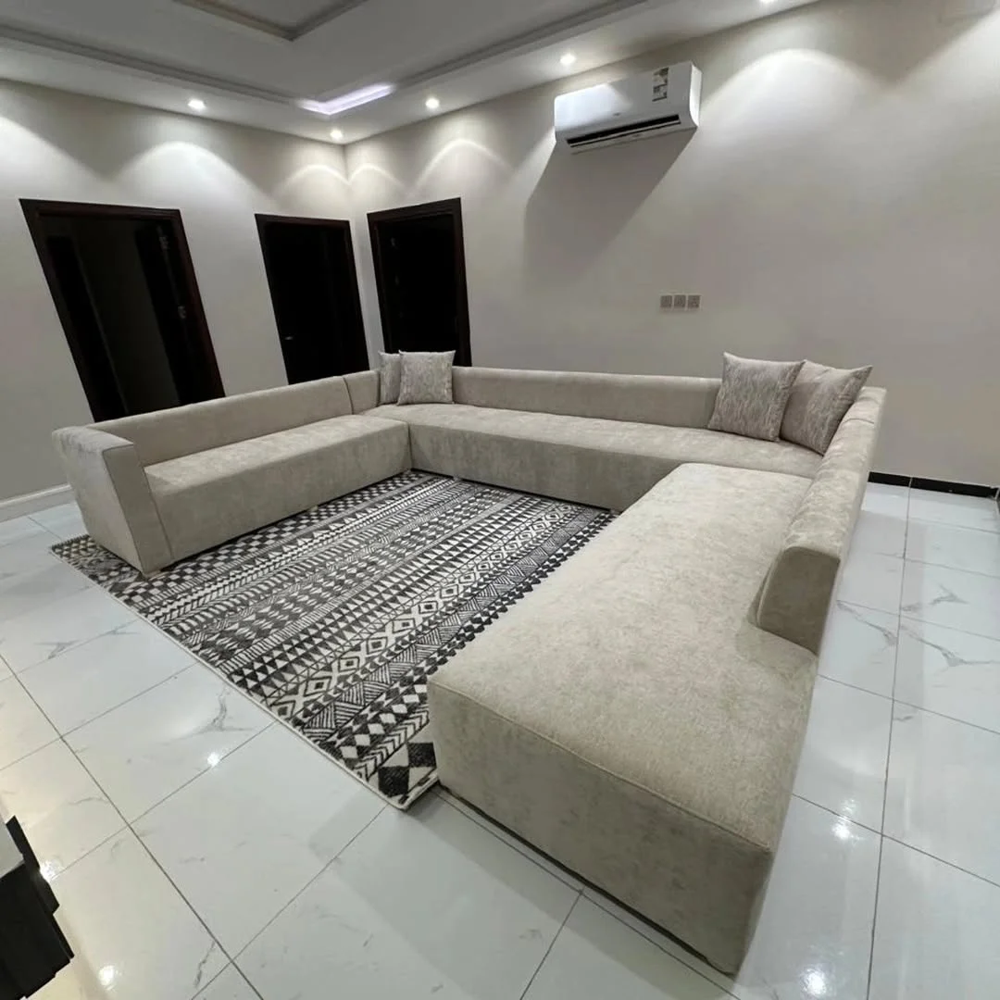

أغلب البيوت في الكويت أرضياتها **رخام أو سيراميك فاتح**. والكنب الذي يناسبها يتبع قواعد بسيطة.

## الألوان المحايدة

**البيج** و**الرمادي الفاتح** و**الأوف وايت** تناسب الأرضيات الفاتحة، وتُظهر الصالة أوسع. وهي أكثر ما نفصّله.

## متى تختار لوناً أغمق؟

- في البيوت مع أطفال: الرمادي المتوسط أو البني الفاتح يخفي الأثر أكثر.
- لإبراز الكنب في صالة كلها فاتحة: كحلي أو أخضر زيتي.

## المخدات تربط الألوان

كنب محايد ومخدات بلون الستارة أو السجادة. مثال من أعمالنا: كنب رمادي فاتح بمخدات **أخضر داكن**.

## الأرجل

أرجل خشب داكنة تبرز على الرخام الأبيض، وأرجل معدنية ذهبية تعطي لمسة مودرن.

## جرّب قبل القرار

اللون على شاشة الجوال يختلف عن الحقيقة. شاهد العينات في [معرضنا بالضجيج](/maarad-dajeej/).
