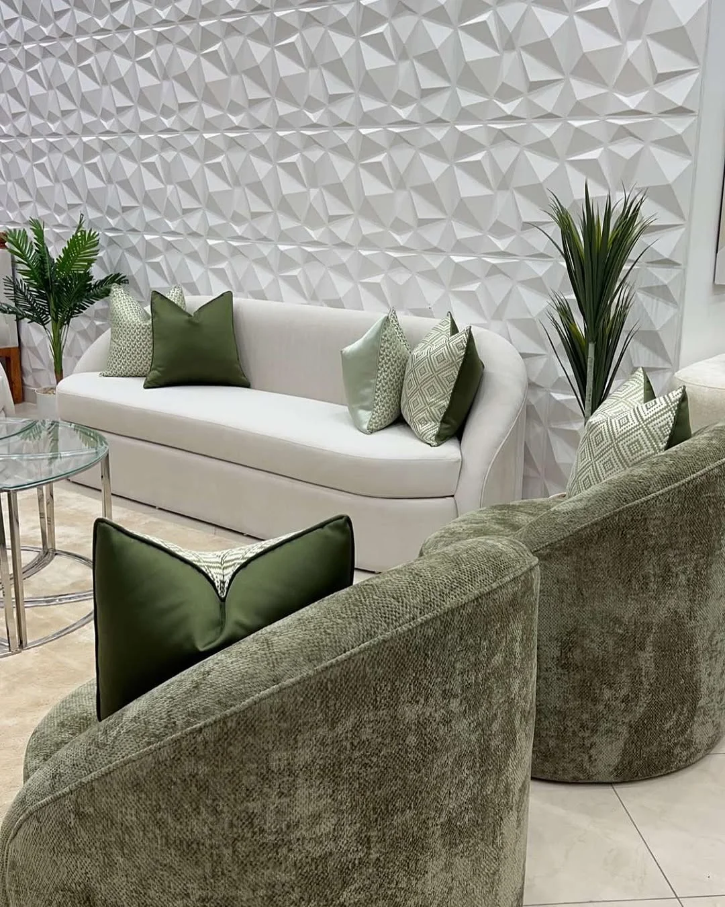

المخدات أسهل طريقة لتغيير شكل الكنب دون تفصيل. وتنسيقها يتبع قواعد بسيطة.

## المقاسات

- **مربعة كبيرة** في الخلف.
- **مربعة أصغر** أمامها.
- **مستطيلة** في الوسط.
- **كروية أو أسطوانية** للمسة مختلفة.

## الألوان

- **لون الكنب بدرجة أغمق أو أفتح**.
- **لون من الستارة أو السجادة** يربط الغرفة.
- **لون مميز** واحد بكمية قليلة: أخضر داكن، أو زيتي، أو عنابي.

## النقوش

اجمع مخدة سادة مع مخدة منقوشة بنفس اللون. النقوش الهندسية الصغيرة تناسب الكنب المودرن.

## العدد

لا تغطِّ الظهر كاملاً بالمخدات، اترك مساحة للجلوس. في الكنب ذي مخدات الظهر المنفصلة، مخدتان أو ثلاث زينة تكفي.

اقرأ [ألوان الكنب مع الرخام](/blog/sofa-colour-marble-floor/).
