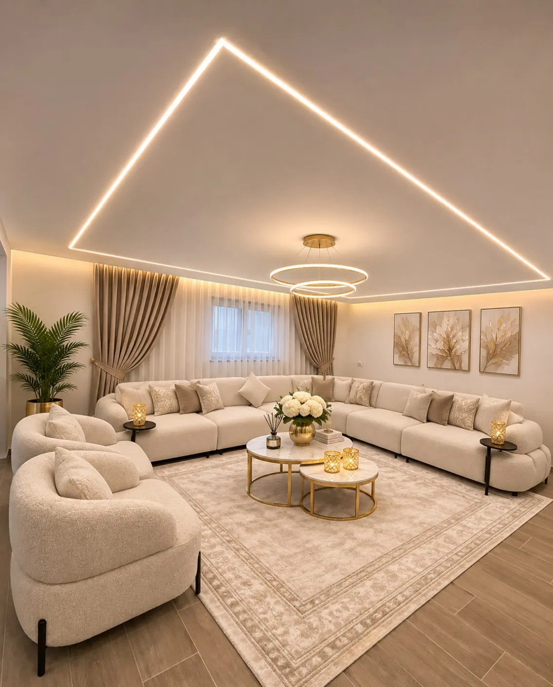

الكنب في بيت فيه أطفال يتعرض لاستخدام مختلف: قفز، وأكل، وأقلام. والاختيار الصحيح قبل التفصيل يوفر عليك كثيراً.

## القماش

- **منسوج كثيف** مثل التويد والشانيل يتحمل الاحتكاك.
- تجنب الأقمشة اللامعة جداً التي يظهر عليها كل أثر.

## اللون

الرمادي المتوسط والبيج الغامق يخفيان الأثر أكثر من الأبيض والأوف وايت. اقرأ [ألوان الكنب مع الرخام](/blog/sofa-colour-marble-floor/).

## التصميم

- **أطراف مستديرة** بدل الحواف الحادة.
- **أرجل قوية** قصيرة.
- **مخدات مقعد منفصلة** يمكن تقليبها.

## إطالة العمر

- امنع القفز على المقاعد، فهو أسرع طريق لهبوط الإسفنج. اقرأ [متى يحتاج الإسفنج تغيير](/blog/sofa-foam-when-to-replace/).
- نظّف البقع فوراً. اقرأ [تنظيف الكنب القماش](/blog/clean-fabric-sofa-at-home/).
