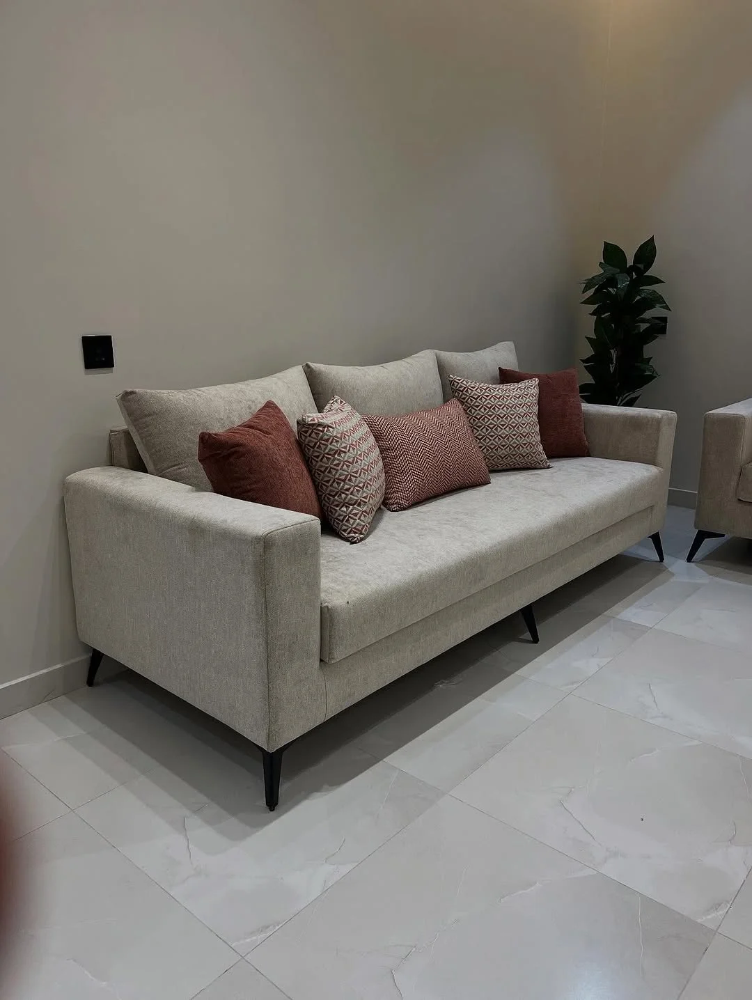

الرجل المتخلخلة تجعل الكنب يميل ويُصدر صوتاً، ومع الوقت تضر بالقاعدة. وإصلاحها مبكراً أسهل.

## علامات المشكلة

- الكنب **يتأرجح** عند الجلوس.
- **صوت** عند الحركة من جهة الرجل.
- رجل **مائلة أو مشقوقة**.

## إصلاح أم تغيير؟

- **رجل متخلخلة:** غالباً تُثبّت من جديد.
- **رجل مكسورة أو مشقوقة:** تُغيّر.
- **تريد شكلاً جديداً:** يمكن تغيير الأرجل كلها، مثلاً من خشب إلى معدن ذهبي أو أسود، حسب ما تسمح به قاعدة الكنب.

## حدود الخدمة

[تصليح الكنب](/tasleeh-kanab/) عندنا يشمل **الأرجل والإسفنج فقط**، في مشغلنا بالضجيج. ولا نصلّح الكنب المكسور الهيكل.

## نصيحة

عند نقل الكنب **ارفعه ولا تسحبه**. السحب على الأرض أكثر سبب لتخلخل الأرجل.
